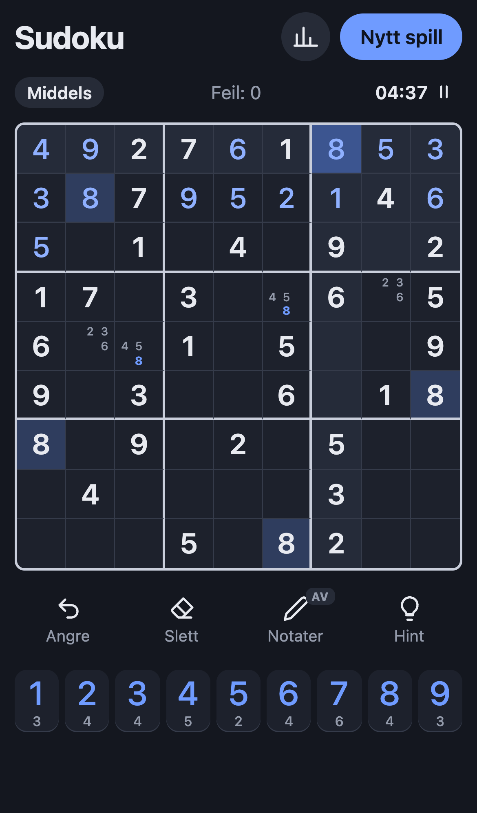
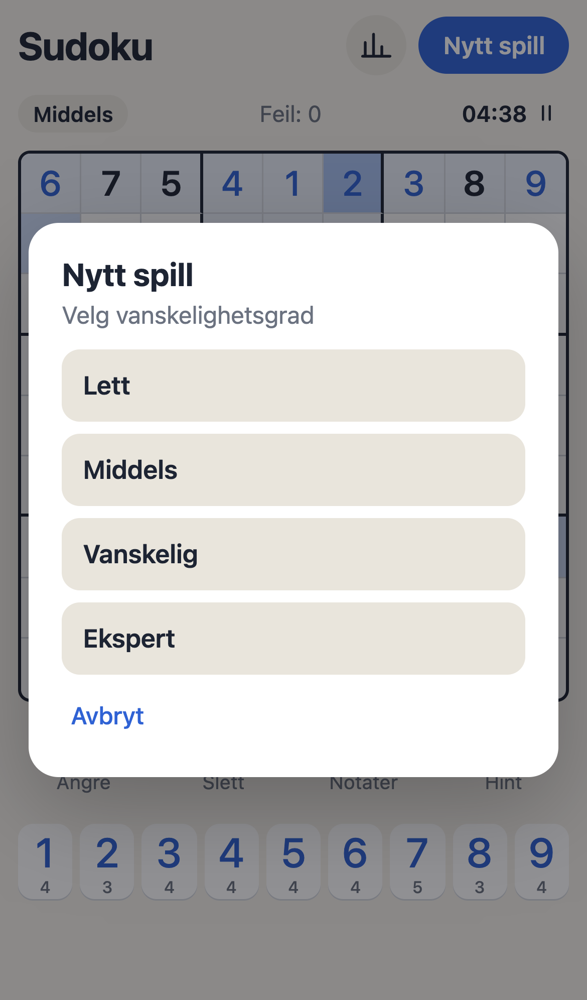
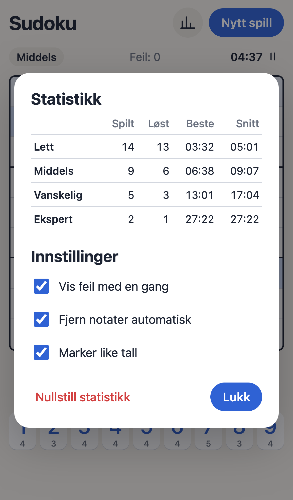

# Sudoku

Sudoku som PWA (ren HTML/CSS/JS), laget for GitHub Pages og «Legg til på Hjem-skjerm» på iPhone/iPad.

**▶ Spill nå: [runesor.github.io/sudoku-app](https://runesor.github.io/sudoku-app/)**

<table>
  <tr>
    <td></td>
    <td></td>
    <td></td>
    <td></td>
  </tr>
  <tr>
    <td align="center">Lys modus</td>
    <td align="center">Mørk modus</td>
    <td align="center">Nytt spill</td>
    <td align="center">Statistikk</td>
  </tr>
</table>

## Funksjoner

- Tilfeldige brett med entydig løsning, fire nivåer: Lett (40 gitte tall), Middels (32), Vanskelig (27), Ekspert (~23–24)
- Notater (blyantmodus), angre, slett og hint
- Feilteller og valgfri umiddelbar feilmarkering
- Markering av rad/kolonne/boks og like tall
- Tidtaker som pauser automatisk når appen legges i bakgrunnen
- Alt lagres i `localStorage`: pågående spill, statistikk per nivå (spilt, løst, beste og snittid) og innstillinger
- Fungerer offline via service worker
- Lys og mørk modus etter systeminnstilling
- Tastatur på desktop: 1–9, Backspace, piltaster, `N` (notater), `H` (hint), `Ctrl/Cmd+Z`, mellomrom (pause)

## Filer

| Fil | Innhold |
|---|---|
| `index.html` | Oppsett, dialoger og iOS-metatagger |
| `style.css` | Utseende, lys/mørk modus, safe-area for iPhone |
| `sudoku.js` | Generator og løser (bitmask-backtracking, sjekker unik løsning) |
| `app.js` | Spillogikk, UI, lagring og statistikk |
| `sw.js` | Service worker for offline-bruk |
| `manifest.webmanifest` | PWA-manifest |
| `icons/` | App-ikoner |
| `.nojekyll` | Hindrer at GitHub Pages kjører Jekyll |
| `screenshots/` | Skjermbilder til README (ikke del av appen) |

## Publisering på GitHub Pages

```bash
git init
git add .
git commit -m "Sudoku PWA"
git branch -M main
git remote add origin https://github.com/<brukernavn>/sudoku.git
git push -u origin main
```

Deretter på GitHub: **Settings → Pages → Build and deployment → Source: Deploy from a branch → `main` / `(root)`**.
Appen blir tilgjengelig på `https://<brukernavn>.github.io/sudoku/` – denne versjonen ligger på <https://runesor.github.io/sudoku-app/>.

Alle stier er relative, så det fungerer i en undermappe uten endringer.

## Installere på iPhone/iPad

Åpne adressen i Safari → Del-knappen → **Legg til på Hjem-skjerm**.

## Oppdatere

Når du endrer filer: øk `CACHE`-versjonen øverst i `sw.js` (f.eks. `sudoku-v2`), ellers kan iOS fortsette å vise den gamle versjonen fra cachen. Lukk og åpne appen på nytt (noen ganger to ganger) for å få ny versjon.

## Lokal testing

```bash
python3 -m http.server 8000
# åpne http://localhost:8000
```
